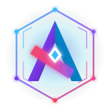

# AniNexus API — Official Documentation & Showcase Website

[](#)

The official documentation, showcase, and interactive playground website for **AniNexus API** — the open Master Franchise & Anime Intelligence platform.

---

## 🌟 Key Features

- **Master Franchise Vault**: 353+ curated franchises spanning 2010 to 2026 with consolidated multi-season timelines, movies, and specials.
- **Dual Community Scoring Engine**: Unified weighted score blending verified independent global community consensus.
- **100% Verified Dub Matrix**: Verified audio dub and subtitle mapping (Hindi, English, Japanese, Bengali, Tamil, Telugu).
- **5-Year Rolling Anime Awards Engine**: Official Crunchyroll Anime Awards winners & nominees (2021–2026) with automated 6th-year auto-purge.
- **Seasonal Airing Hub**: Real-time seasonal tracker with current airing titles (`/seasons/now`), upcoming releases, and historical archives.
- **Interactive API Playground**: Real-time request execution against live Render gateway (`https://ani-nexus.onrender.com`) with latency monitoring and syntax-highlighted responses.
- **Zero-Token Auth & CORS**: Instant access with standard HTTP clients without API keys.

---

## 🚀 Tech Stack

- **Framework**: [SvelteKit](https://kit.svelte.dev/) with Svelte 4
- **Styling**: SCSS & Modular CSS
- **Adapter**: `@sveltejs/adapter-static` for Cloudflare Pages & static web hosting
- **Icons**: `@tabler/icons-svelte`
- **Animations**: `svelte-typewriter`, Svelte Transitions, and 3D card tilt

---

## 🛠️ Local Development

```bash
# Install dependencies
npm install

# Start development server
npm run dev

# Build for production
npm run build

# Preview production build locally
npm run preview
```

---

## ☁️ Deployment (Cloudflare Pages)

1. Connect this repository to **Cloudflare Pages**.
2. Set Framework Preset: `SvelteKit`.
3. Set Build Command: `npm run build`.
4. Set Output Directory: `build`.

---

## 📄 License

MIT License. Designed and maintained by the AniNexus Open Initiative.
